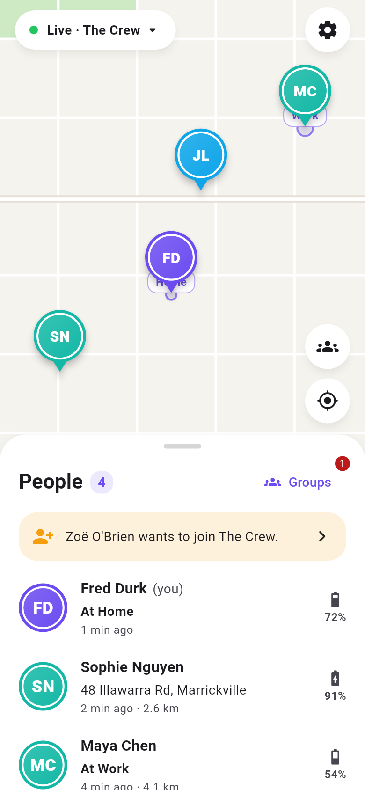
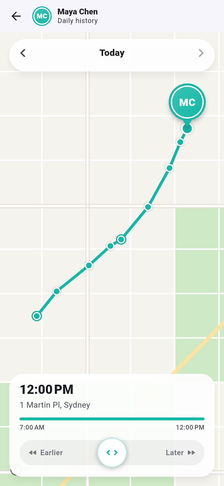
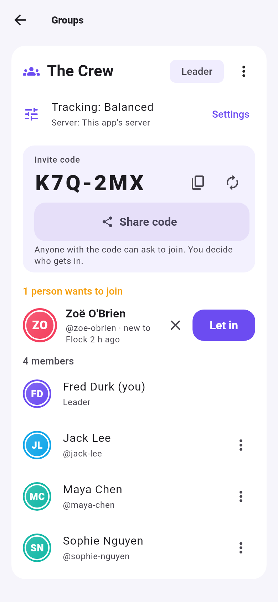
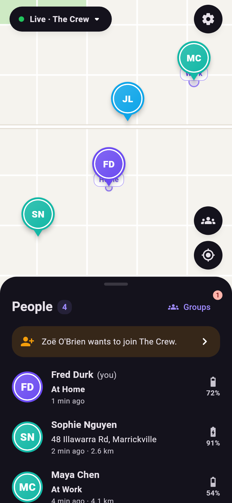

# Flock

A friendly location-sharing app for **friend groups**, on **Android and iOS**, that runs on your own
[OwnTracks](https://owntracks.org) server. It looks and works like Life360,
and your data stays on your server.

<p>




</p>

> The map in these screenshots is a placeholder drawn for testing. The app
> itself uses real map tiles (CARTO / OpenStreetMap, or Google Maps if
> you turn it on).

## What it does

- **A map of everyone.** Each person shows as a photo or initials pin, with a
  list you drag up from the bottom showing address, "4 min ago", distance from
  you, and battery level.
- **Tap a person** to see where they are, ask their phone for a fresh location
  (**Refresh**), open **Directions**, or view their **History**.
- **History:** a Daily History screen for the last 3 days. The day's path is
  drawn on the map, and a joystick moves through it. Tap any point for its
  time and address. History comes from the OwnTracks Recorder.
- **Profile photos:** pick one, move and zoom it in a circle, and tap
  anyone's photo to see it full size. Sent as standard OwnTracks `card` messages, so no server
  changes are needed. They also show up in the official OwnTracks apps and
  the Recorder's web page.
- **Setup:** enter your name (and a photo), tap **Create my account**, then
  start a group or enter a code someone sent you. There are no passwords to
  hand out: the server makes a login for each person.
- **Groups:** the leader shares a short invite code like `K7Q-2MX`. Anyone with
  the code can ask to join, and the leader sees their name and photo and taps
  **Let in**. You only see people you share a group with, and the broker
  enforces that.
- **Group settings:** each group carries its server and tracking mode
  (Saver/Balanced/Precise), set by the leader. Members get them
  automatically and never see a server setting. The groups that existed
  first run on this app's server; every new group brings its own (an MQTT
  broker its leader runs) and can't track until the leader adds it. If
  you're in more than one group, you pick which one is on your map.
- **Battery modes:** Saver, Balanced, or Precise.
- **Maps:** Google Maps by default (when the build has a key), with
  Satellite, Streets, Terrain and Dark styles. Satellite is the default.
  OpenStreetMap is the alternative in Settings, with Esri satellite photos.
- **Dark mode**, and an **Advanced** section in Settings that stays tucked away.

## How people are set up

Everyone has **their own account**, made by the server at sign-up. The
username comes from the person's name, and the device is always `phone`:

| Person      | Username      | Topic                          |
|-------------|---------------|--------------------------------|
| Fred Durk   | `fred-durk`   | `owntracks/fred-durk/phone`    |
| Zoë O'Brien | `zoe-obrien`  | `owntracks/zoe-obrien/phone`   |

The password is random and stays in the phone's secure storage, so nobody has
to type or share it. Someone with the same name gets `-2`, `-3` and so on.
Usernames only show up when the leader is checking a request.

The app subscribes to `owntracks/+/+`, and the broker's ACL (written by the
server from the groups) only delivers people you share a group with.
Messages use the standard OwnTracks JSON format.

## Server requirements

> This build is set up for one server: its address, port and private CA
> certificate are built in. See [docs/SERVER.md](docs/SERVER.md).

- **Mosquitto** with a password file and an ACL file, both managed by
  **flock-server** (in [`server/`](server/), Python standard library only). It
  handles sign-up, groups, invite codes and approvals, and checks history
  requests.
- **The OwnTracks Recorder** for History, behind Caddy on port 8443 together
  with flock-server's API.

## Building

This is a Flutter app: one codebase for both platforms.

```bash
flutter pub get
```

```bash
flutter run
```

**Android**

```bash
flutter build apk --release
```

**iOS** (needs a Mac with Xcode and an Apple developer account for signing):

```bash
flutter build ios --release
```

### Releases

Push a tag like `v0.2.0` and GitHub Actions runs the tests, builds the Android
APK and an unsigned iPhone build, and publishes them as a GitHub release.

To make Android updates install over previous versions, every release must be
signed with the same key. Create one once:

```bash
keytool -genkey -v -keystore flock-release.jks -keyalg RSA -keysize 2048 -validity 10000 -alias flock
```

Then add two repository secrets (Settings → Secrets and variables → Actions):
`ANDROID_KEYSTORE_BASE64` (output of `base64 -w0 flock-release.jks`) and
`ANDROID_KEYSTORE_PASSWORD`. If your alias isn't `flock`, or the key has its
own password, also add `ANDROID_KEY_ALIAS` and `ANDROID_KEY_PASSWORD`. Keep the `.jks` file safe; losing it means everyone
has to uninstall and reinstall. Optionally add `GOOGLE_API_KEY` to enable Google
Maps in release builds, and `CARTO_API_KEY` for the standard map. CARTO's free key
(carto.com/basemaps/apikey) is required: without it every tile says "API KEY REQUIRED".

### Turning on Google Maps (optional)

Google Maps is used by default when the build includes an API key;
without one the app uses OpenStreetMap.
Google's Maps SDKs for Android and iOS currently cost nothing to use, but
Google still requires a Cloud project with billing turned on. Create a key in
Google Cloud Console, enable *Maps SDK for Android* and *Maps SDK for iOS*,
then:

- **Android:** add `MAPS_API_KEY=your-key` to `android/local.properties`
- **iOS:** create `ios/Flutter/Secrets.xcconfig` containing
  `GOOGLE_MAPS_API_KEY=your-key`

Both files are git-ignored. Release builds take the key from the
`GOOGLE_API_KEY` repository secret.

## Tests

```bash
flutter test
```

To run the end-to-end tests against a real broker (needs `mosquitto` with user
`family` / password `hunter2`):

```bash
MQTT_TEST_PORT=18830 flutter test test/mqtt_integration_test.dart
```

To regenerate the screenshots:

```bash
SCREENSHOTS=1 flutter test test/screenshots/screenshots_test.dart
```

## Known limitations

- **Not yet run on a real phone.** It compiles, passes its tests, and the
  screens render, but Android and iOS builds haven't been tried on devices.
- **Background tracking stops if the app is force-closed.** On Android, a
  "Sharing your location" notification keeps it running in the background.
  On iOS it keeps running with "Always" location permission. If someone swipes
  the app away (Android) or force-quits it (iOS), updates stop until they open
  it again.
- **No place alerts yet** (Life360's "Maya arrived at Home"). OwnTracks
  supports this through waypoints, so it's the natural next feature.

## License

MIT. This is a new app that speaks the OwnTracks protocol; it doesn't include
code from the OwnTracks apps.
